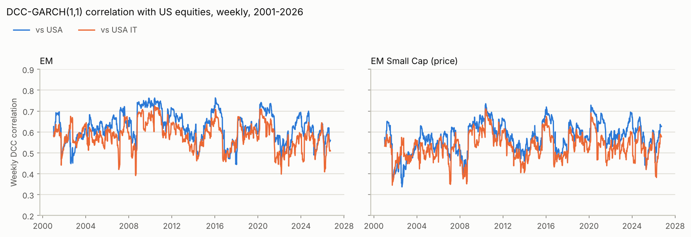
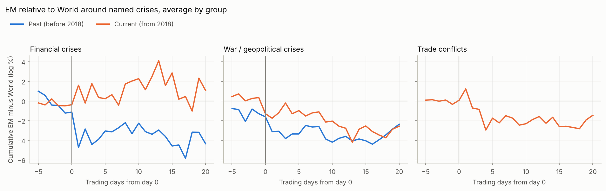
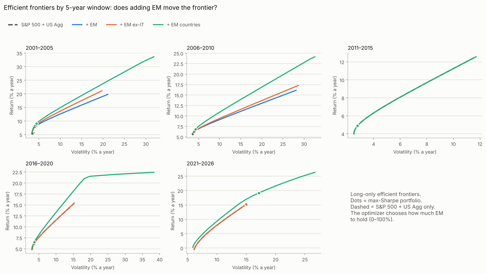
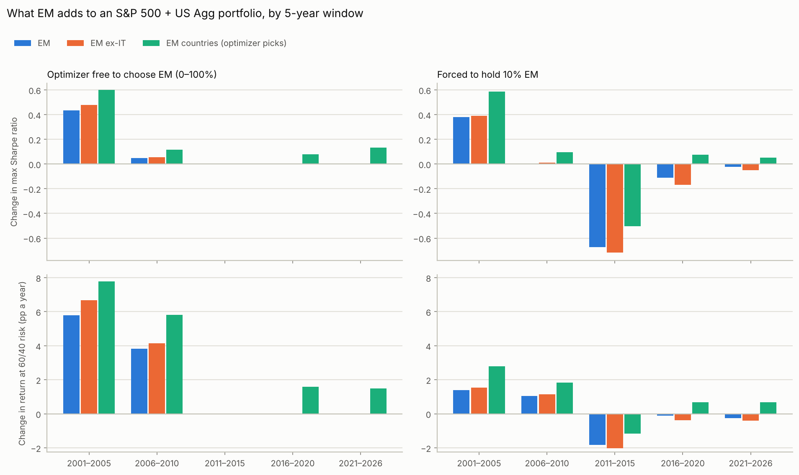

# GlobeFlex B - results summary

Generated by `python run_all.py`. All returns are monthly log returns in % unless stated.
Significance: * 10%, ** 5%, *** 1% (Newey-West).

## Data
| index | first | last | observations | note |
|---|---|---|---|---|
| monthly returns | 2001-01 | 2026-09 | 309 |  |
| weekly returns (Step 1) | 2001-01-05 | 2026-09-25 | 1343 |  |
| daily returns (event study) | 2001-01-01 | 2026-09-25 | 6715 | MSCI data end 2026-09-25 |

Crisis months in the monthly sample: Fin = 134, Geo = 53, either = 169 of 309.
IT weight in MSCI EM: 17.9% (2001-01) -> 41.6% (2026-08).

## Step 1 - DCC-GARCH(1,1) correlations (weekly)
| index | estimate | std_err |
|---|---|---|
| a | 0.0258 | 0.0060 |
| b | 0.9512 | 0.0151 |
| a+b | 0.9770 |  |
| corr_loglik | 2586.3849 |  |
| weeks | 1343 |  |

Average DCC correlation by year:
| year | EM vs USA | EM vs USA IT | EM Small Cap (price) vs USA | EM Small Cap (price) vs USA IT |
|---|---|---|---|---|
| 2001 | 0.61 | 0.57 | 0.54 | 0.50 |
| 2002 | 0.53 | 0.59 | 0.42 | 0.49 |
| 2003 | 0.58 | 0.59 | 0.49 | 0.50 |
| 2004 | 0.62 | 0.57 | 0.57 | 0.50 |
| 2005 | 0.62 | 0.57 | 0.55 | 0.51 |
| 2006 | 0.64 | 0.58 | 0.56 | 0.53 |
| 2007 | 0.66 | 0.59 | 0.55 | 0.51 |
| 2008 | 0.62 | 0.56 | 0.49 | 0.46 |
| 2009 | 0.73 | 0.66 | 0.64 | 0.58 |
| 2010 | 0.74 | 0.69 | 0.68 | 0.64 |
| 2011 | 0.67 | 0.61 | 0.62 | 0.57 |
| 2012 | 0.68 | 0.62 | 0.59 | 0.55 |
| 2013 | 0.60 | 0.55 | 0.51 | 0.47 |
| 2014 | 0.55 | 0.52 | 0.55 | 0.51 |
| 2015 | 0.66 | 0.62 | 0.59 | 0.55 |
| 2016 | 0.66 | 0.59 | 0.63 | 0.56 |
| 2017 | 0.51 | 0.52 | 0.51 | 0.48 |
| 2018 | 0.62 | 0.61 | 0.61 | 0.57 |
| 2019 | 0.62 | 0.60 | 0.58 | 0.55 |
| 2020 | 0.70 | 0.65 | 0.66 | 0.59 |
| 2021 | 0.64 | 0.55 | 0.61 | 0.52 |
| 2022 | 0.54 | 0.50 | 0.57 | 0.53 |
| 2023 | 0.63 | 0.55 | 0.62 | 0.54 |
| 2024 | 0.63 | 0.56 | 0.61 | 0.54 |
| 2025 | 0.57 | 0.56 | 0.53 | 0.51 |
| 2026 | 0.58 | 0.52 | 0.57 | 0.50 |

## Step 2 - Is EM more like the US, and is technology the cause?
Bai-Perron single break (EM on USA): last month of regime 1 = **2009-10**, Post_t = 1 from 2009-11. supF(1) = 17.24 (5% critical value 11.47).

| breaks | ssr | bic | break_months | bic_choice |
|---|---|---|---|---|
| 0 | 4957.7682 | 2.8125 |  |  |
| 1 | 4454.3333 | 2.7611 | 2009-10 | <- min BIC |
| 2 | 4337.0564 | 2.7900 | 2008-02, 2012-12 |  |
| 3 | 4237.8873 | 2.8226 | 2004-10, 2009-10, 2016-05 |  |
| 4 | 4181.6091 | 2.8649 | 2004-10, 2009-07, 2018-02, 2022-10 |  |
| 5 | 4166.6514 | 2.9170 | 2004-10, 2009-10, 2014-02, 2018-02, 2022-10 |  |

Equation (1): r_EM = alpha + beta r_US + delta (interaction x r_US). w_IT,t-1 is a fraction (0-1), so delta is the change in beta per 100 pp of IT weight.

| dependent | interaction | sample | N | beta | delta | t_delta | R2 |
|---|---|---|---|---|---|---|---|
| EM | Post | All months | 309 | 1.299 | -0.452*** | -3.568 | 0.587 |
| EM | Post | Non-crisis months | 140 | 1.683 | -0.927*** | -2.577 | 0.397 |
| EM | w_IT,t-1 | All months | 309 | 1.602 | -3.332* | -1.669 | 0.577 |
| EM | w_IT,t-1 | Non-crisis months | 140 | 1.075 | -1.200 | -0.546 | 0.350 |
| EM ex-IT | Post | All months | 309 | 1.261 | -0.505*** | -3.458 | 0.536 |
| EM ex-IT | Post | Non-crisis months | 140 | 1.755 | -1.042*** | -2.955 | 0.365 |
| EM ex-IT | w_IT,t-1 | All months | 309 | 1.927 | -5.621*** | -3.921 | 0.549 |
| EM ex-IT | w_IT,t-1 | Non-crisis months | 140 | 1.291 | -2.513 | -1.145 | 0.312 |
| EM Small Cap (price) | Post | All months | 309 | 1.271 | -0.372** | -2.055 | 0.563 |
| EM Small Cap (price) | Post | Non-crisis months | 140 | 1.543 | -0.730** | -2.216 | 0.430 |
| EM Small Cap (price) | w_IT,t-1 | All months | 309 | 1.798 | -4.351** | -2.239 | 0.571 |
| EM Small Cap (price) | w_IT,t-1 | Non-crisis months | 140 | 0.937 | -0.272 | -0.131 | 0.399 |
| EM (price) | Post | All months | 309 | 1.297 | -0.446*** | -3.527 | 0.586 |
| EM (price) | Post | Non-crisis months | 140 | 1.681 | -0.925** | -2.560 | 0.398 |
| EM (price) | w_IT,t-1 | All months | 309 | 1.602 | -3.328* | -1.663 | 0.577 |
| EM (price) | w_IT,t-1 | Non-crisis months | 140 | 1.083 | -1.240 | -0.565 | 0.351 |

## Step 3 - Crisis behaviour today versus the past
Equation (2), dependent = EM (or EM ex-IT) minus World. Current = from 2018. Columns ending 'no Post' drop the Post_t term.

| index | EM - World, no X | EM - World, with X | EM ex-IT - World, no X | EM ex-IT - World, with X | EM - World, no X, no Post | EM - World, with X, no Post | EM ex-IT - World, no X, no Post | EM ex-IT - World, with X, no Post |
|---|---|---|---|---|---|---|---|---|
| g1 Fin | 0.001 | 0.051 | 0.029 | 0.095 | 0.560 | 0.540 | 0.712 | 0.685 |
| t: g1 Fin | 0.001 | 0.120 | 0.061 | 0.210 | 1.084 | 1.139 | 1.320 | 1.387 |
| g2 Geo | 0.071 | -0.072 | 0.033 | -0.100 | 0.689 | 0.464 | 0.788 | 0.546 |
| t: g2 Geo | 0.072 | -0.063 | 0.042 | -0.107 | 0.736 | 0.407 | 1.084 | 0.589 |
| g3 Fin x Current | -0.026 | 0.034 | 0.157 | 0.227 | -0.881 | -0.705 | -0.886 | -0.664 |
| t: g3 Fin x Current | -0.038 | 0.049 | 0.193 | 0.266 | -1.216 | -0.988 | -1.058 | -0.764 |
| g4 Geo x Current | 0.191 | 0.403 | -0.250 | -0.038 | -0.741 | -0.403 | -1.388 | -1.009 |
| t: g4 Geo x Current | 0.163 | 0.312 | -0.255 | -0.036 | -0.666 | -0.317 | -1.509 | -0.963 |
| theta Post | -1.507 | -1.319 | -1.840 | -1.591 |  |  |  |  |
| t: theta Post | -3.115 | -2.876 | -3.627 | -3.350 |  |  |  |  |
| alpha | 1.085 | 0.925 | 1.194 | 0.983 | -0.093 | -0.106 | -0.244 | -0.261 |
| t: alpha | 2.289 | 2.049 | 2.382 | 2.086 | -0.309 | -0.387 | -0.750 | -0.876 |
| g1+g3 (current Fin) | -0.025 | 0.085 | 0.186 | 0.323 | -0.320 | -0.165 | -0.174 | 0.021 |
| t: g1+g3 (current Fin) | -0.040 | 0.135 | 0.247 | 0.407 | -0.490 | -0.254 | -0.223 | 0.026 |
| g2+g4 (current Geo) | 0.263 | 0.331 | -0.217 | -0.138 | -0.051 | 0.061 | -0.600 | -0.463 |
| t: g2+g4 (current Geo) | 0.452 | 0.616 | -0.414 | -0.302 | -0.088 | 0.113 | -1.098 | -0.973 |
| R2 | 0.041 | 0.109 | 0.062 | 0.156 | 0.012 | 0.086 | 0.021 | 0.126 |
| N | 309 | 309 | 309 | 309 | 309 | 309 | 309 | 309 |
| Fin months, past | 116 | 116 | 116 | 116 | 116 | 116 | 116 | 116 |
| Fin months, current | 18 | 18 | 18 | 18 | 18 | 18 | 18 | 18 |
| Geo months, past | 16 | 16 | 16 | 16 | 16 | 16 | 16 | 16 |
| Geo months, current | 37 | 37 | 37 | 37 | 37 | 37 | 37 | 37 |
| phi dVIX |  | 0.023 |  | 0.061 |  | 0.029 |  | 0.068 |
| t: phi dVIX |  | 0.386 |  | 0.968 |  | 0.498 |  | 1.097 |
| phi dDXY |  | -0.425 |  | -0.531 |  | -0.447 |  | -0.558 |
| t: phi dDXY |  | -3.927 |  | -4.834 |  | -4.232 |  | -5.200 |

Daily event study: cumulative EM minus World (log %), from day -5.

| crisis | type | period | day0 | CAR[-5,-1] | CAR[-5,+0] | CAR[-5,+5] | CAR[-5,+10] | CAR[-5,+20] |
|---|---|---|---|---|---|---|---|---|
| Lehman bankruptcy | Fin | Past | 2008-09-15 | -3.14 | -3.00 | -1.75 | -3.24 | -7.61 |
| US downgrade / euro crisis | Fin | Past | 2011-08-08 | 0.09 | 0.33 | -3.45 | -1.95 | -1.47 |
| China devaluation | Fin | Past | 2015-08-11 | -0.65 | -0.75 | -3.98 | -1.61 | -3.97 |
| 9/11 attacks | Geo | Past | 2001-09-11 | 1.59 | -0.24 | -3.85 | -6.02 | -7.92 |
| Iraq invasion | Geo | Past | 2003-03-20 | -5.26 | -3.94 | -4.73 | -5.15 | -1.87 |
| Crimea annexation | Geo | Past | 2014-03-03 | -0.23 | -0.67 | -1.50 | -1.42 | 2.65 |
| COVID crash | Fin | Current | 2020-02-24 | -0.83 | -0.50 | 1.00 | 4.27 | 3.92 |
| SVB collapse | Fin | Current | 2023-03-10 | -0.17 | -0.27 | -0.55 | 0.27 | -1.77 |
| Russia invades Ukraine | Geo | Current | 2022-02-24 | 2.00 | -2.32 | -2.06 | -5.72 | -8.38 |
| Hamas attack on Israel | Geo | Current | 2023-10-09 | -1.37 | -2.05 | -1.82 | -1.40 | 0.42 |
| Israel-Iran war | Geo | Current | 2025-06-13 | 0.41 | 0.46 | 0.91 | 0.96 | 0.24 |
| US Section 301 China tariffs | Trade | Current | 2018-03-22 | 0.43 | 1.09 | -0.90 | -1.87 | -2.09 |
| US-China tariff escalation | Trade | Current | 2019-05-06 | 0.24 | -1.14 | -1.86 | -5.03 | -0.61 |
| Yuan breaks 7 / new tariffs | Trade | Current | 2019-08-05 | -1.34 | -1.98 | -2.81 | -3.14 | -2.72 |
| 'Liberation Day' tariffs | Trade | Current | 2025-04-03 | -0.70 | 2.29 | -1.43 | 0.74 | -0.43 |

Average by group:

| index | n events | CAR[-5,-1] | CAR[-5,+0] | CAR[-5,+5] | CAR[-5,+10] | CAR[-5,+20] |
|---|---|---|---|---|---|---|
| Current Fin | 2 | -0.50 | -0.38 | 0.23 | 2.27 | 1.07 |
| Current Geo | 3 | 0.35 | -1.30 | -0.99 | -2.05 | -2.57 |
| Current Trade | 4 | -0.34 | 0.06 | -1.75 | -2.32 | -1.46 |
| Past Fin | 3 | -1.24 | -1.14 | -3.06 | -2.27 | -4.35 |
| Past Geo | 3 | -1.30 | -1.62 | -3.36 | -4.20 | -2.38 |

## Step 4 - Mean-variance optimizer: S&P 500 + US Agg, with and without EM
Long-only efficient frontiers in each window, from sample means and covariances of monthly returns. Max Sharpe = tangency portfolio (rf = average 3-month T-bill). 'At 60/40 risk' = highest return the assets can reach at the volatility of a 60/40 S&P 500 / US Agg portfolio. 'Fixed 10%' forces the EM asset (or the EM countries together) to exactly 10%.

5-year windows:

| window | months | portfolio | max Sharpe | change vs S&P+Agg | EM weight in max-Sharpe % | 60/40 volatility % | best return at 60/40 risk % | return gain at 60/40 risk (pp) | EM weight at 60/40 risk % |
|---|---|---|---|---|---|---|---|---|---|
| 2001–2005 | 60 | S&P 500 + US Agg | 0.96 | 0.00 | 0.00 | 8.55 | 5.80 | 0.00 | 0.00 |
| 2001–2005 | 60 | + EM | 1.39 | 0.43 | 15.20 | 8.55 | 11.60 | 5.80 | 41.37 |
| 2001–2005 | 60 | + EM ex-IT | 1.44 | 0.48 | 17.41 | 8.55 | 12.47 | 6.67 | 43.57 |
| 2001–2005 | 60 | + EM countries | 1.56 | 0.60 | 12.37 | 8.55 | 13.57 | 7.77 | 30.27 |
| 2001–2005 | 60 | + EM, fixed 10% | 1.34 | 0.38 | 10.00 | 8.55 | 7.20 | 1.40 | 10.00 |
| 2001–2005 | 60 | + EM ex-IT, fixed 10% | 1.35 | 0.39 | 10.00 | 8.55 | 7.33 | 1.53 | 10.00 |
| 2001–2005 | 60 | + EM countries, together 10% | 1.54 | 0.59 | 10.00 | 8.55 | 8.58 | 2.78 | 10.00 |
| 2006–2010 | 60 | S&P 500 + US Agg | 0.96 | 0.00 | 0.00 | 11.01 | 5.71 | 0.00 | 0.00 |
| 2006–2010 | 60 | + EM | 1.01 | 0.05 | 4.36 | 11.01 | 9.54 | 3.82 | 36.67 |
| 2006–2010 | 60 | + EM ex-IT | 1.01 | 0.05 | 4.59 | 11.01 | 9.86 | 4.15 | 35.86 |
| 2006–2010 | 60 | + EM countries | 1.07 | 0.12 | 6.19 | 11.01 | 11.53 | 5.81 | 31.80 |
| 2006–2010 | 60 | + EM, fixed 10% | 0.96 | 0.00 | 10.00 | 11.01 | 6.76 | 1.04 | 10.00 |
| 2006–2010 | 60 | + EM ex-IT, fixed 10% | 0.97 | 0.01 | 10.00 | 11.01 | 6.87 | 1.16 | 10.00 |
| 2006–2010 | 60 | + EM countries, together 10% | 1.05 | 0.10 | 10.00 | 11.01 | 7.56 | 1.84 | 10.00 |
| 2011–2015 | 60 | S&P 500 + US Agg | 1.73 | 0.00 | 0.00 | 6.93 | 8.83 | 0.00 | 0.00 |
| 2011–2015 | 60 | + EM | 1.73 | 0.00 | 0.00 | 6.93 | 8.83 | -0.00 | 0.00 |
| 2011–2015 | 60 | + EM ex-IT | 1.73 | 0.00 | 0.00 | 6.93 | 8.83 | -0.00 | 0.00 |
| 2011–2015 | 60 | + EM countries | 1.73 | -0.00 | 0.00 | 6.93 | 8.83 | -0.00 | 0.00 |
| 2011–2015 | 60 | + EM, fixed 10% | 1.06 | -0.67 | 10.00 | 6.93 | 7.01 | -1.82 | 10.00 |
| 2011–2015 | 60 | + EM ex-IT, fixed 10% | 1.02 | -0.72 | 10.00 | 6.93 | 6.82 | -2.01 | 10.00 |
| 2011–2015 | 60 | + EM countries, together 10% | 1.23 | -0.50 | 10.00 | 6.93 | 7.66 | -1.18 | 10.00 |
| 2016–2020 | 60 | S&P 500 + US Agg | 1.40 | 0.00 | 0.00 | 9.24 | 11.00 | 0.00 | 0.00 |
| 2016–2020 | 60 | + EM | 1.40 | 0.00 | 0.00 | 9.24 | 11.00 | -0.00 | 0.00 |
| 2016–2020 | 60 | + EM ex-IT | 1.40 | 0.00 | 0.00 | 9.24 | 11.00 | -0.00 | 0.00 |
| 2016–2020 | 60 | + EM countries | 1.48 | 0.08 | 11.89 | 9.24 | 12.59 | 1.59 | 38.55 |
| 2016–2020 | 60 | + EM, fixed 10% | 1.29 | -0.11 | 10.00 | 9.24 | 10.88 | -0.12 | 10.00 |
| 2016–2020 | 60 | + EM ex-IT, fixed 10% | 1.23 | -0.17 | 10.00 | 9.24 | 10.62 | -0.38 | 10.00 |
| 2016–2020 | 60 | + EM countries, together 10% | 1.47 | 0.08 | 10.00 | 9.24 | 11.68 | 0.68 | 10.00 |
| 2021–2026 | 69 | S&P 500 + US Agg | 0.79 | 0.00 | 0.00 | 10.63 | 8.91 | 0.00 | 0.00 |
| 2021–2026 | 69 | + EM | 0.79 | 0.00 | 0.00 | 10.63 | 8.91 | 0.00 | 0.00 |
| 2021–2026 | 69 | + EM ex-IT | 0.79 | 0.00 | 0.00 | 10.63 | 8.91 | 0.00 | 0.00 |
| 2021–2026 | 69 | + EM countries | 0.92 | 0.13 | 66.05 | 10.63 | 10.40 | 1.49 | 42.70 |
| 2021–2026 | 69 | + EM, fixed 10% | 0.77 | -0.02 | 10.00 | 10.63 | 8.65 | -0.26 | 10.00 |
| 2021–2026 | 69 | + EM ex-IT, fixed 10% | 0.74 | -0.05 | 10.00 | 10.63 | 8.51 | -0.40 | 10.00 |
| 2021–2026 | 69 | + EM countries, together 10% | 0.84 | 0.05 | 10.00 | 10.63 | 9.58 | 0.67 | 10.00 |

10-year windows:

| window | months | portfolio | max Sharpe | change vs S&P+Agg | EM weight in max-Sharpe % | 60/40 volatility % | best return at 60/40 risk % | return gain at 60/40 risk (pp) | EM weight at 60/40 risk % |
|---|---|---|---|---|---|---|---|---|---|
| 2001–2010 | 120 | S&P 500 + US Agg | 0.94 | 0.00 | 0.00 | 9.82 | 5.76 | 0.00 | 0.00 |
| 2001–2010 | 120 | + EM | 1.12 | 0.18 | 9.37 | 9.82 | 10.44 | 4.69 | 38.35 |
| 2001–2010 | 120 | + EM ex-IT | 1.14 | 0.19 | 10.01 | 9.82 | 10.92 | 5.16 | 38.39 |
| 2001–2010 | 120 | + EM countries | 1.17 | 0.23 | 8.78 | 9.82 | 11.28 | 5.53 | 32.17 |
| 2001–2010 | 120 | + EM, fixed 10% | 1.12 | 0.18 | 10.00 | 9.82 | 6.98 | 1.22 | 10.00 |
| 2001–2010 | 120 | + EM ex-IT, fixed 10% | 1.14 | 0.19 | 10.00 | 9.82 | 7.10 | 1.34 | 10.00 |
| 2001–2010 | 120 | + EM countries, together 10% | 1.17 | 0.22 | 10.00 | 9.82 | 7.51 | 1.75 | 10.00 |
| 2011–2020 | 120 | S&P 500 + US Agg | 1.53 | 0.00 | 0.00 | 8.14 | 9.92 | 0.00 | 0.00 |
| 2011–2020 | 120 | + EM | 1.53 | 0.00 | 0.00 | 8.14 | 9.92 | -0.00 | 0.00 |
| 2011–2020 | 120 | + EM ex-IT | 1.53 | 0.00 | 0.00 | 8.14 | 9.92 | -0.00 | 0.00 |
| 2011–2020 | 120 | + EM countries | 1.53 | -0.00 | 0.00 | 8.14 | 9.92 | -0.00 | 0.00 |
| 2011–2020 | 120 | + EM, fixed 10% | 1.16 | -0.36 | 10.00 | 8.14 | 8.96 | -0.95 | 10.00 |
| 2011–2020 | 120 | + EM ex-IT, fixed 10% | 1.11 | -0.41 | 10.00 | 8.14 | 8.74 | -1.17 | 10.00 |
| 2011–2020 | 120 | + EM countries, together 10% | 1.32 | -0.20 | 10.00 | 8.14 | 9.66 | -0.26 | 10.00 |
| 2016–2026 | 120 | S&P 500 + US Agg | 0.86 | 0.00 | 0.00 | 10.21 | 9.91 | 0.00 | 0.00 |
| 2016–2026 | 120 | + EM | 0.86 | -0.00 | 0.00 | 10.21 | 9.91 | -0.00 | 0.00 |
| 2016–2026 | 120 | + EM ex-IT | 0.86 | 0.00 | 0.00 | 10.21 | 9.91 | 0.00 | 0.00 |
| 2016–2026 | 120 | + EM countries | 0.98 | 0.12 | 60.36 | 10.21 | 11.12 | 1.20 | 37.29 |
| 2016–2026 | 120 | + EM, fixed 10% | 0.84 | -0.02 | 10.00 | 10.21 | 9.63 | -0.29 | 10.00 |
| 2016–2026 | 120 | + EM ex-IT, fixed 10% | 0.82 | -0.04 | 10.00 | 10.21 | 9.38 | -0.54 | 10.00 |
| 2016–2026 | 120 | + EM countries, together 10% | 0.91 | 0.05 | 10.00 | 10.21 | 10.47 | 0.56 | 10.00 |

## Robustness
### 1. EM Small Cap net returns, post-2010
DCC (weekly, post-2010):

| index | weeks | mean corr vs USA | mean corr vs USA IT |
|---|---|---|---|
| EM Small Cap (price) | 852 | 0.602 | 0.544 |
| EM Small Cap (net) | 852 | 0.602 | 0.544 |

Equation (1), post-2010 months. The Post interaction is not estimable here: the break is 2009-10, so Post_t = 1 in every post-2010 month (Post x r_US = r_US).

| dependent | interaction | sample | N | beta | delta | t_delta | R2 |
|---|---|---|---|---|---|---|---|
| EM Small Cap (net) | w_IT,t-1 | All months | 196 | 1.132 | -1.084 | -0.587 | 0.542 |
| EM Small Cap (net) | w_IT,t-1 | Non-crisis months | 109 | 0.421 | 2.292 | 1.533 | 0.500 |
| EM Small Cap (price) | w_IT,t-1 | All months | 196 | 1.143 | -1.131 | -0.607 | 0.543 |
| EM Small Cap (price) | w_IT,t-1 | Non-crisis months | 109 | 0.431 | 2.236 | 1.527 | 0.499 |
| EM | w_IT,t-1 | All months | 196 | 0.948 | -0.382 | -0.166 | 0.502 |
| EM | w_IT,t-1 | Non-crisis months | 109 | 0.399 | 2.131 | 1.407 | 0.414 |
| EM (price) | w_IT,t-1 | All months | 196 | 0.955 | -0.407 | -0.176 | 0.504 |
| EM (price) | w_IT,t-1 | Non-crisis months | 109 | 0.417 | 2.041 | 1.326 | 0.416 |

### 2. Local-currency EM returns (Step 3)
| index | EM (USD) - World, no X | EM (USD) - World, with X | EM (local ccy) - World, no X | EM (local ccy) - World, with X |
|---|---|---|---|---|
| g1 Fin | 0.001 | 0.051 | 0.134 | 0.144 |
| t: g1 Fin | 0.001 | 0.120 | 0.384 | 0.411 |
| g2 Geo | 0.071 | -0.072 | -0.036 | 0.156 |
| t: g2 Geo | 0.072 | -0.063 | -0.031 | 0.137 |
| g3 Fin x Current | -0.026 | 0.034 | 0.223 | 0.205 |
| t: g3 Fin x Current | -0.038 | 0.049 | 0.336 | 0.350 |
| g4 Geo x Current | 0.191 | 0.403 | 0.547 | 0.327 |
| t: g4 Geo x Current | 0.163 | 0.312 | 0.436 | 0.261 |
| theta Post | -1.507 | -1.319 | -1.310 | -1.259 |
| t: theta Post | -3.115 | -2.876 | -3.595 | -3.324 |
| alpha | 1.085 | 0.925 | 0.952 | 0.914 |
| t: alpha | 2.289 | 2.049 | 2.609 | 2.479 |
| g1+g3 (current Fin) | -0.025 | 0.085 | 0.357 | 0.349 |
| t: g1+g3 (current Fin) | -0.040 | 0.135 | 0.566 | 0.650 |
| g2+g4 (current Geo) | 0.263 | 0.331 | 0.511 | 0.483 |
| t: g2+g4 (current Geo) | 0.452 | 0.616 | 1.057 | 1.021 |
| R2 | 0.041 | 0.109 | 0.044 | 0.092 |
| N | 309 | 309 | 309 | 309 |
| Fin months, past | 116 | 116 | 116 | 116 |
| Fin months, current | 18 | 18 | 18 | 18 |
| Geo months, past | 16 | 16 | 16 | 16 |
| Geo months, current | 37 | 37 | 37 | 37 |
| phi dVIX |  | 0.023 |  | 0.131 |
| t: phi dVIX |  | 0.386 |  | 2.746 |
| phi dDXY |  | -0.425 |  | 0.008 |
| t: phi dDXY |  | -3.927 |  | 0.090 |

### 3. Current period from 2022 (Step 3)
| index | EM - World, no X | EM - World, with X | EM ex-IT - World, no X | EM ex-IT - World, with X |
|---|---|---|---|---|
| g1 Fin | 0.118 | 0.152 | 0.134 | 0.180 |
| t: g1 Fin | 0.275 | 0.370 | 0.296 | 0.419 |
| g2 Geo | -0.504 | -0.574 | -0.425 | -0.480 |
| t: g2 Geo | -0.738 | -0.750 | -0.773 | -0.770 |
| g3 Fin x Current | -0.318 | -0.212 | -0.084 | 0.048 |
| t: g3 Fin x Current | -0.498 | -0.317 | -0.106 | 0.054 |
| g4 Geo x Current | 1.320 | 1.449 | 0.536 | 0.657 |
| t: g4 Geo x Current | 1.516 | 1.626 | 0.685 | 0.869 |
| theta Post | -1.573 | -1.376 | -1.884 | -1.628 |
| t: theta Post | -3.378 | -3.081 | -3.860 | -3.523 |
| alpha | 1.089 | 0.929 | 1.189 | 0.980 |
| t: alpha | 2.304 | 2.071 | 2.386 | 2.098 |
| g1+g3 (current Fin) | -0.199 | -0.060 | 0.049 | 0.228 |
| t: g1+g3 (current Fin) | -0.348 | -0.099 | 0.068 | 0.271 |
| g2+g4 (current Geo) | 0.816 | 0.875 | 0.110 | 0.177 |
| t: g2+g4 (current Geo) | 1.433 | 1.692 | 0.191 | 0.359 |
| R2 | 0.047 | 0.115 | 0.062 | 0.157 |
| N | 309 | 309 | 309 | 309 |
| Fin months, past | 119 | 119 | 119 | 119 |
| Fin months, current | 15 | 15 | 15 | 15 |
| Geo months, past | 24 | 24 | 24 | 24 |
| Geo months, current | 29 | 29 | 29 | 29 |
| phi dVIX |  | 0.021 |  | 0.060 |
| t: phi dVIX |  | 0.356 |  | 0.948 |
| phi dDXY |  | -0.426 |  | -0.533 |
| t: phi dDXY |  | -3.894 |  | -4.806 |
